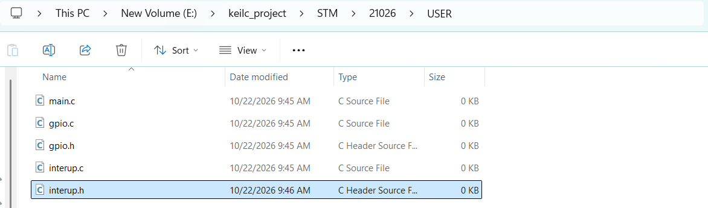
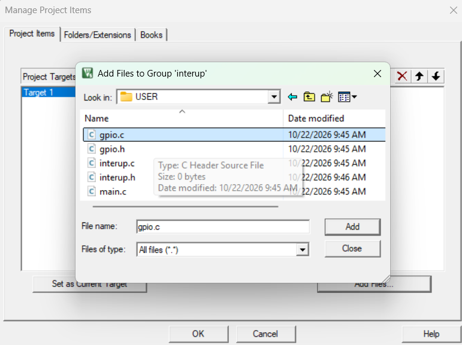
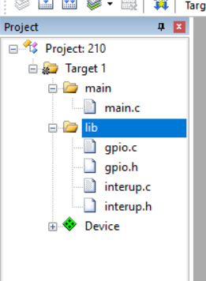
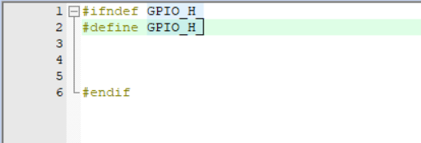

# ELE-D24-Nguyen Quang Thang 247 - Báo cáo công việc 25/9/2026 - Lớp STM32

## A, Những thứ đã học được 
    - Tạo thư viện trong keilc
    - Ngắt(interrupt) trong stm32
## B, Báo cáo
    - Tạo thư viện người dùng trong keilc
bước 1: ở trong thư mục project, vào file user

bước2:tạo đủ các file header và file code trong đây


bước 3:chọn biẻu tượng này :


bước 4: tạo folder main rồi cho add file main.c vào , tạo thư mục lib rồi add các file thư viện vào:


Bước 5: bấm ok thì nó sẽ hiện ra như thế này;


    - Các bước viét file thư viện 
- Khi viêt sthwu viện cần phải khai báo những bước này 
    + tác dụng: để tránh việc một file header bị khai báo nhiều lần trong cùng một quá trình biên dịch.


- Ngắt trong stm32:
    Ngắt (interrupt) cho phép vi điều khiển tạm dừng luồng xử lý hiện tại để phản hồi một sự kiện. Sau khi hoàn thành hàm phục vụ ngắt, chương trình tiếp tục từ vị trí đã tạm dừng. Sự kiện có thể đến từ ngoại vi bên trong hoặc từ chân bên ngoài, ví dụ nút nhấn nối với EXTI.

Các thành phần thường liên quan đến ngắt ngoài:

EXTI: phát hiện cạnh lên, cạnh xuống hoặc cả hai cạnh trên chân được cấu hình.
NVIC: cho phép ngắt và quản lý mức ưu tiên của ngắt.
ISR/IRQ handler: hàm xử lý ngắt ở mức ngoại vi và vi điều khiển.


bài tập về nhà 
```c
#include "stm32f10x.h"

void delay_ms (uint16_t time_ms) {
	for (uint32_t i =0; i<time_ms; i++) {
		for(uint32_t j=0; j<0x2aff; j++);
	}
}
void GPIO_CONFIG(void){
	GPIO_InitTypeDef GPIO;
	RCC_APB2PeriphClockCmd(RCC_APB2Periph_GPIOA|RCC_APB2Periph_AFIO, ENABLE);
	
	// cau hinh nut bam
	GPIO.GPIO_Mode= GPIO_Mode_IPU;
	GPIO.GPIO_Pin=GPIO_Pin_0;
	GPIO_Init(GPIOA,&GPIO);

	// cau hinh led
	GPIO.GPIO_Mode=GPIO_Mode_Out_PP;
	GPIO.GPIO_Pin=GPIO_Pin_1;
	GPIO.GPIO_Speed=GPIO_Speed_50MHz;
	GPIO_Init(GPIOA,&GPIO);
	
}
void exti_config(void){
	EXTI_InitTypeDef EXTI_INIT;
	NVIC_InitTypeDef NVIC_INIT;
	
	GPIO_EXTILineConfig(GPIO_PortSourceGPIOA,GPIO_PinSource0);
	
	EXTI_INIT.EXTI_Line=EXTI_Line0;
	EXTI_INIT.EXTI_Mode=EXTI_Mode_Interrupt;
	EXTI_INIT.EXTI_Trigger=EXTI_Trigger_Falling;
	EXTI_INIT.EXTI_LineCmd=ENABLE;
	EXTI_Init(&EXTI_INIT);
	
	NVIC_INIT.NVIC_IRQChannel=EXTI0_IRQn;
	NVIC_INIT.NVIC_IRQChannelPreemptionPriority=0;
	NVIC_INIT.NVIC_IRQChannelSubPriority=0;
	NVIC_INIT.NVIC_IRQChannelCmd=ENABLE;
	NVIC_Init(&NVIC_INIT);
}
void EXTI0_IRQHandler(void ){
	if(EXTI_GetFlagStatus(EXTI_Line0)!=RESET){  // chua biet 
		delay_ms(20);
		if(GPIO_ReadInputDataBit(GPIOA,GPIO_Pin_0)==0){
			if(GPIO_ReadOutputDataBit(GPIOA,GPIO_Pin_1)){
				GPIO_ResetBits(GPIOA,GPIO_Pin_1);
			}
			else{
				GPIO_SetBits(GPIOA,GPIO_Pin_1);
			}
		}
		EXTI_ClearITPendingBit(EXTI_Line0);
	}
}
int main(){
	GPIO_CONFIG();
	exti_config();
	while(1){
	}
}
```