# ELE-D24-Nguyen Quang Thang 247 - Báo cáo công việc 25/9/2026 - Lớp STM32

## A, Những thứ đã học được 
    - Các Bước cấu tạo 1 project
    - Các thanh ghi cấu hình GPIO
    - Cách Cấu hình GPIO
## B, Báo cáo
    - Các bước tạo một project
        + Tạo một folder chưa project
        + bên trong chúa 2 folder con là MDK và USER

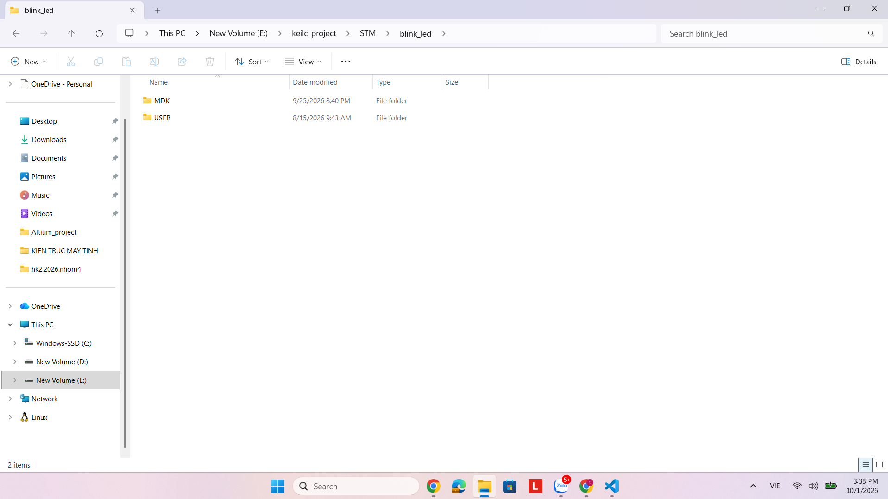

        + vào keilc và cọn phần new project trong phần project

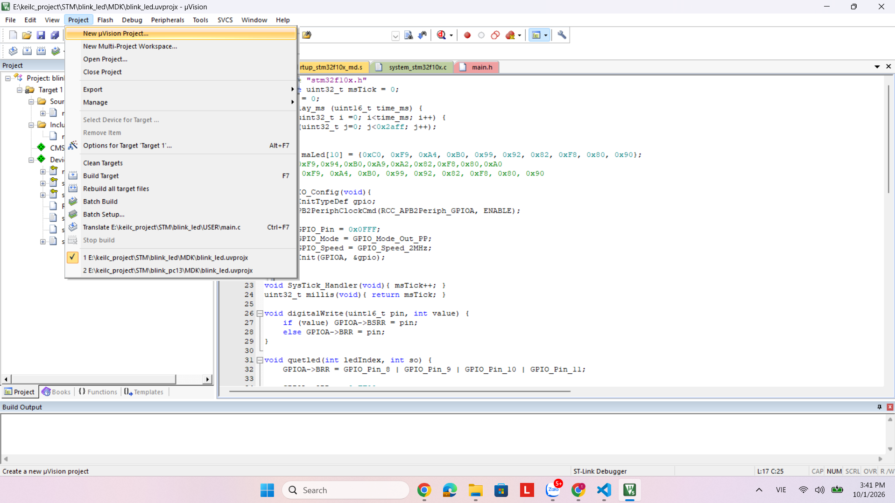

        + Lưu vào trong folder MDK mình vừa tạo

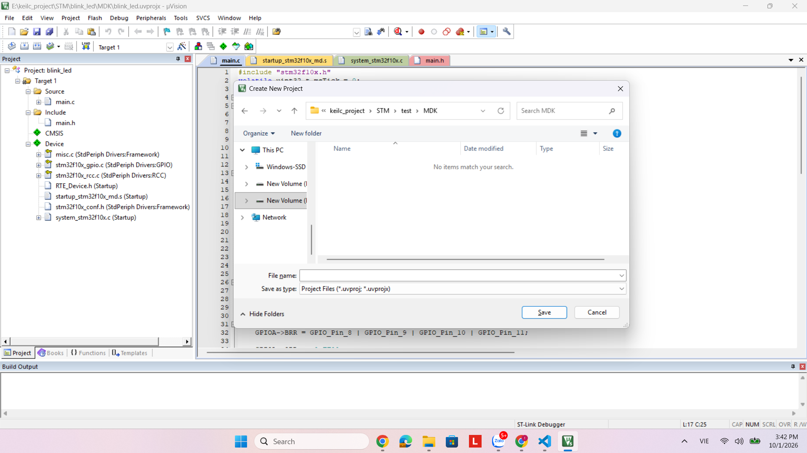

        + Chọn đúng loại chip mình cần 

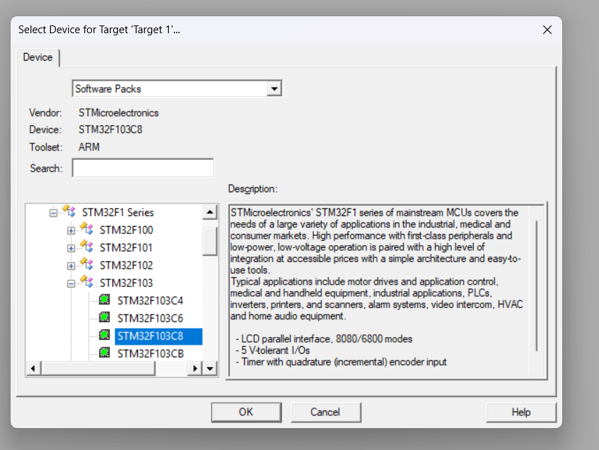

        + Chon những ngoại vi mình cần và bấm resole
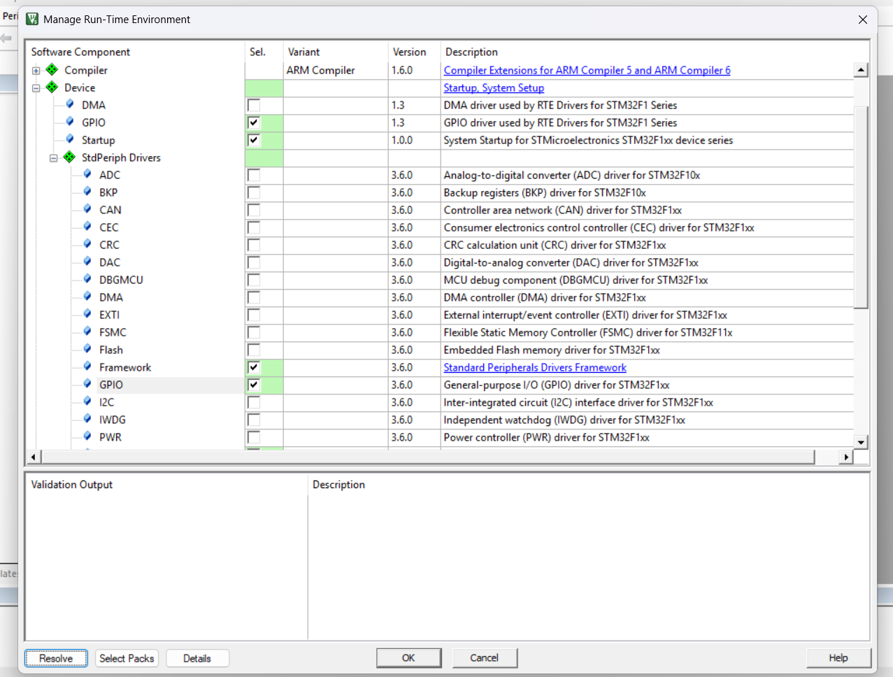

        + Trong file USER tạo file code của mình
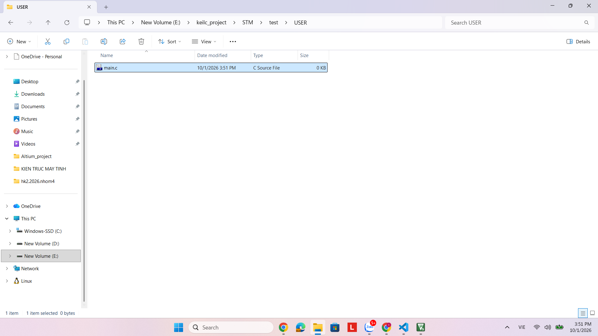

        + add file code của mình vào 
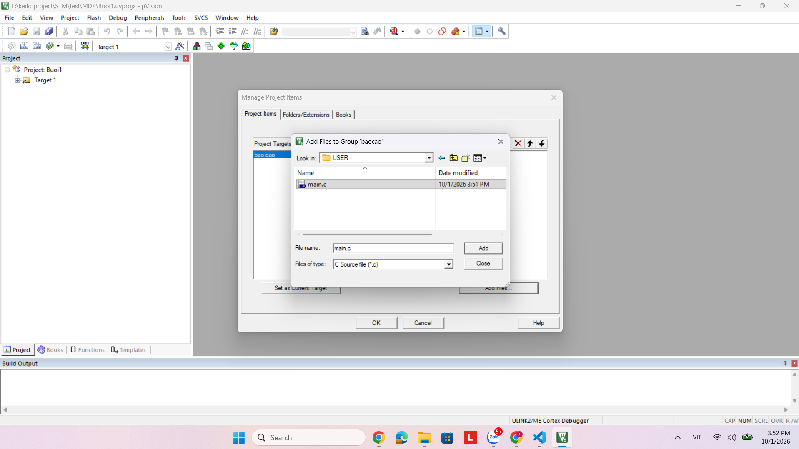
- Các thanh ghi để cấu hình 1 gpio
    + GPIO (General Purpose Input/Output) là các chân vào/ra số của STM32.

    + Một GPIO thường có các chức năng cơ bản:

         + Input: đọc mức logic từ bên ngoài.
         +Output: xuất mức 0 hoặc 1.
        + Alternate Function: sử dụng chân cho ngoại vi như UART, SPI, Timer...
        + Analog: sử dụng chân cho ADC hoặc chức năng analog.

    + bước 1:cấu hình clock : bật tắt nháy led cho gpio ta sử dụng nguồn clock ngoại trên bus apb2 : thanh ghi APB2 peripheral clock enable register (RCC_APB2ENR)

    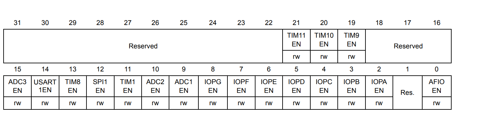
    + Để nháy led 13 gpioc t bật bit thứ 4 của thanh ghi 
    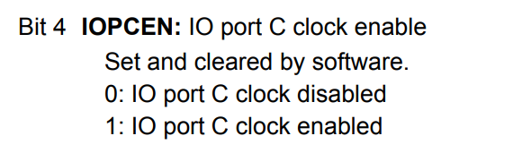

    + Bước 2 : cấu hình các thanh ghi liên quan đến chân 13 của gpioc
        + Để cấu hình 1 chân gpio t sửu dụng 2 thnah ghi: CRL và CRH
            + GPIOx_CRL Dùng để cấu hình: GPIO0 → GPIO7
            + GPIOx_CRH Dùng để cấu hình: GPIO8 → GPIO15
        Vì vậy: PC13 nằm trong GPIOC_CRH

    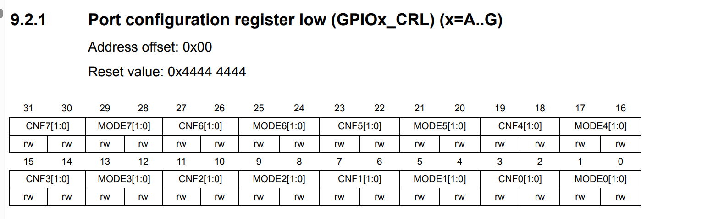

    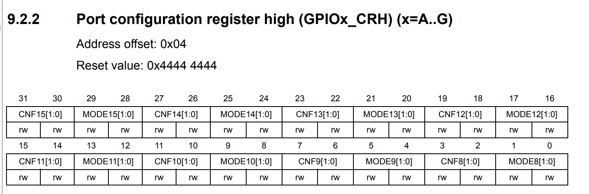

            + Mỗi chân gpio chiếm 4 bit trong thanh ghi
            ( chân 13 gipoc tuowjc bit thứ 20 đến bit thứ 23)

            + 4 bit của mỗi chan GPIO gồn 2 phần : cnf và mode 
                + CNF : là 2 bit sau :quyết định kiểu cấu hình của chân.
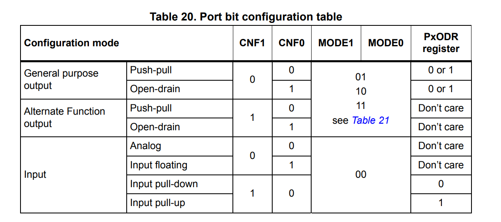 
                + MODE: là 2 bit đầu quyết định chân GPIO hoạt động ở chế độ gì và tốc độ output bao nhiêu.
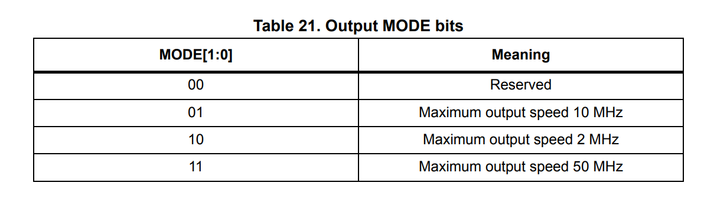

        + để nháy led gpioc 13 : 
            + reset 4 bit 20 đến 23 của thanh ghi crh
            + thiết lập bit 20 đến 23 của thanh ghi crh là 0011 theo thứ tự từ 20 đến 23 
                + 00 :General Purpose Output Push-Pull
                + 11: Output 50 MHz

        + Cấu hình nháy led :
            + GPIOx_IDR là thanh ghi dữ liệu đầu vào (Input Data Register). Nó được sử dụng để đọc trạng thái logic hiện tại của các chân GPIO.

 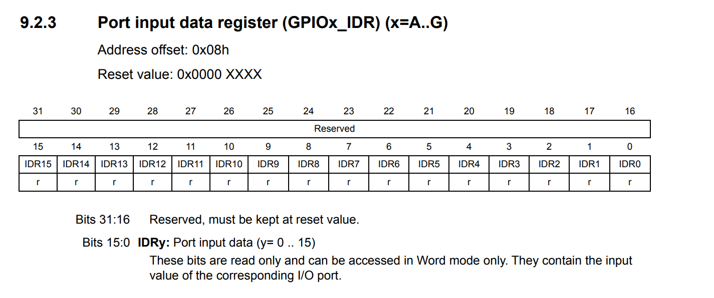
            + GPIOx_ODR — Output Data Register,GPIOx_ODR là thanh ghi dữ liệu đầu ra (Output Data Register).Nó được sử dụng để ghi hoặc đọc giá trị đầu ra của GPIO.
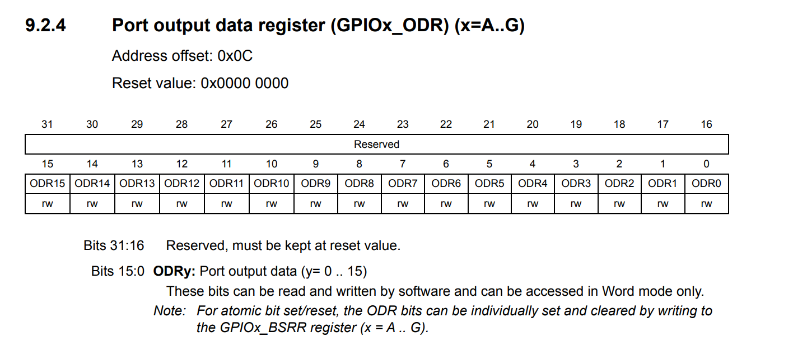
            + GPIOx_BSRR — Bit Set/Reset Register,GPIOx_BSRR là thanh ghi Bit Set/Reset Register.Nó được thiết kế để cho phép SET hoặc RESET từng chân GPIO mà không cần thực hiện thao tác đọc–sửa–ghi trên ODR.
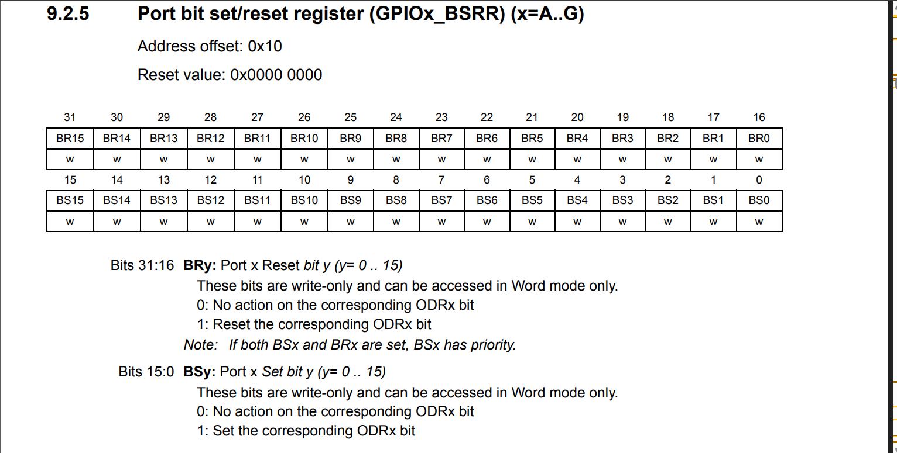

            + GPIOx_BRR — Bit Reset Register,GPIOx_BRR là Bit Reset Register.Nó được sử dụng để đưa từng chân GPIO về mức 0.
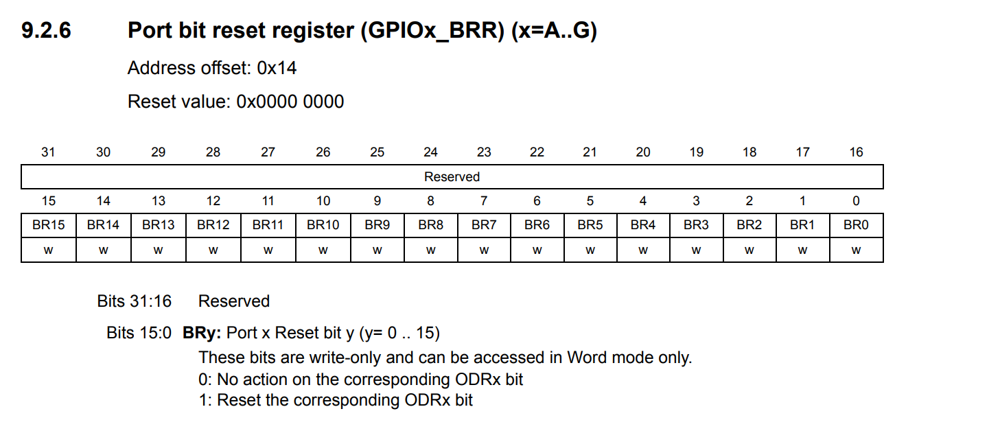


- code hoàn chỉnh nháy led pc13
```c
#include<stm32f10x.h>
void delay_ms(uint32_t ms)
{
    for(uint32_t i = 0; i < ms; i++)
    {
        for(volatile uint32_t j = 0; j < 7200; j++)
        {
        }
    }
}
int main(void)
{
 
    RCC->APB2ENR |= (1 << 4); 

   
    GPIOC->CRH &= ~(0xF << 20);// reset thanh ghi crh 
    GPIOC->CRH |=  (0x3 << 20);// cấu hình chân pc13 lên thanh gho crh

  
    while(1)
    {
        GPIOC->ODR |= (1 << 13);// set bit thứ 13 của thanh ghi odr lên 1
        delay_ms(1000);

        GPIOC->ODR &= ~(1 << 13);// set bit thứ 13 của thanh ghi odr về 0
        delay_ms(1000);
    }
}
```
1

 

